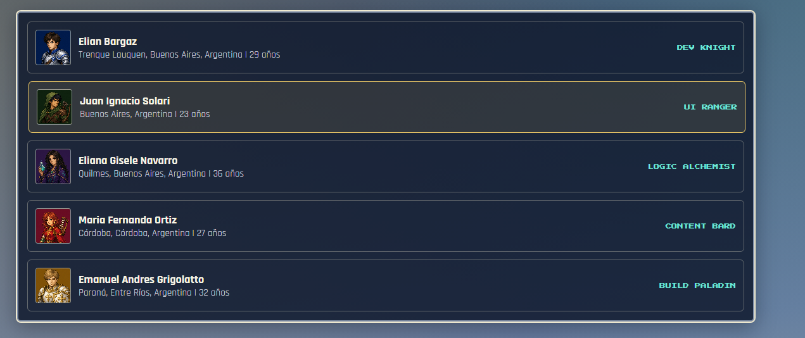
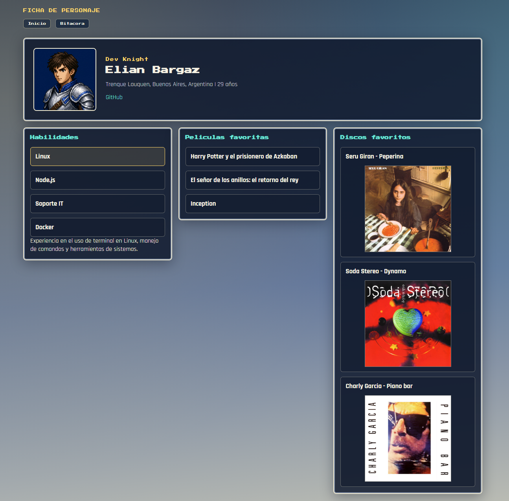
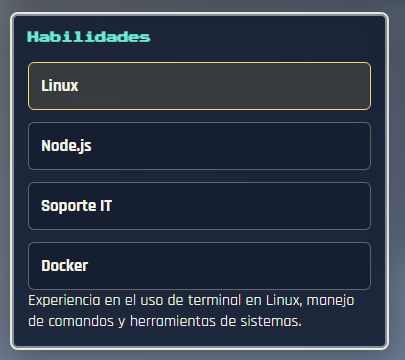
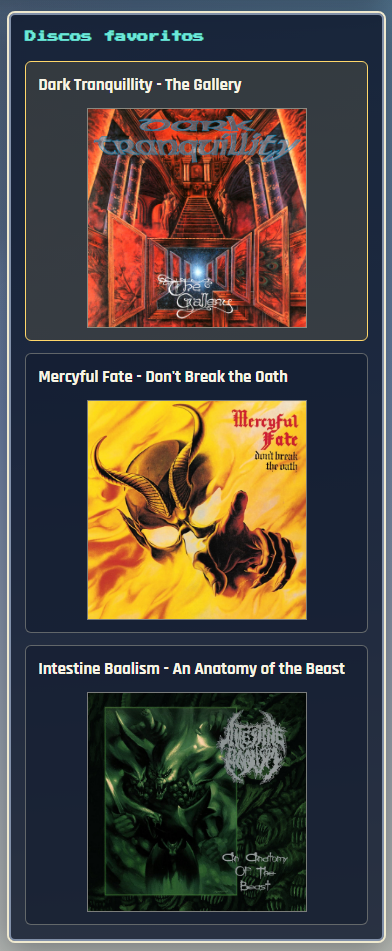
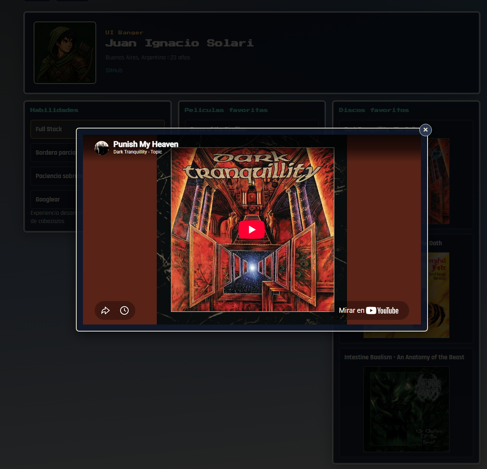

# TP2 - Grupo 28

## Descripción

Aplicación web del Grupo 28 desarrollada en React con una estética inspirada en los RPG. Presenta al equipo, perfiles individuales con habilidades y gustos, y una bitácora del proceso de trabajo. La navegación se organiza mediante una sidebar compartida.

## Sitio publicado

- Vercel: [https://tp-2-front-end-ifts29.vercel.app/](https://tp-2-front-end-ifts29.vercel.app/).

## Integrantes

| Nombre y apellido | Perfil de GitHub |
| --- | --- |
| Elián Bargaz | [Elibar19](https://github.com/Elibar19) |
| Juan Ignacio Solari | [LaWeaArgentina](https://github.com/LaWeaArgentina) |
| Eliana Gisele Navarro | [Eli-Navarr0](https://github.com/Eli-Navarr0) |
| María Fernanda Ortiz | [ortizgonzalezmariafer](https://github.com/ortizgonzalezmariafer) |
| Emanuel Andrés Grigolatto | [egrigolatto](https://github.com/egrigolatto) |

## Uso de IA

| Aplicación utilizada | Modelo utilizado |
| --- | --- |
| Copilot | GPT-5.6 Luna |

---

## Ampliaciones

### Índice

- [Descripción](#descripción)
- [Sitio publicado](#sitio-publicado)
- [Integrantes](#integrantes)
- [Uso de IA](#uso-de-ia)
- [Capturas](#capturas)
- [Tecnologías y estructura](#tecnologías-y-estructura)
- [Ejecución local](#ejecución-local)
- [Rutas](#rutas)

### Capturas

#### Portada



#### Perfil



#### Habilidades



#### Discos favoritos



#### Reproductor



### Tecnologías y estructura

- **React** para construir la interfaz mediante componentes reutilizables.
- **React Router** para navegar entre la portada, los recursos, la API, la bitácora y los perfiles.
- **Vite** para el desarrollo local y la compilación.
- **Fetch API y SWAPI** para consultar y mostrar información de las películas de Star Wars, con estados de carga y error.

```text
src/
  components/  # Layout, sidebar y modal de discos
  data/        # Datos de integrantes y catálogo JSON de recursos web
  pages/       # Portada, recursos, API, perfiles y bitácora
  styles.css   # Estilos compartidos
public/
  img/
    albums/      # Portadas de discos
    avatars/     # Avatares del equipo
    screenshots/ # Capturas de la aplicación
```

### Ejecución local

```bash
npm install
npm run dev
```

Para generar la versión de producción:

```bash
npm run build
```

### Rutas

- `/`: portada del equipo.
- `/recursos`: catálogo local con búsqueda y filtro por categoría.
- `/api`: películas de Star Wars consultadas desde SWAPI.
- `/bitacora`: bitácora del proceso.
- `/arbol`: árbol interactivo de los componentes de React.
- `/perfil/:memberId`: perfil de cada integrante.
